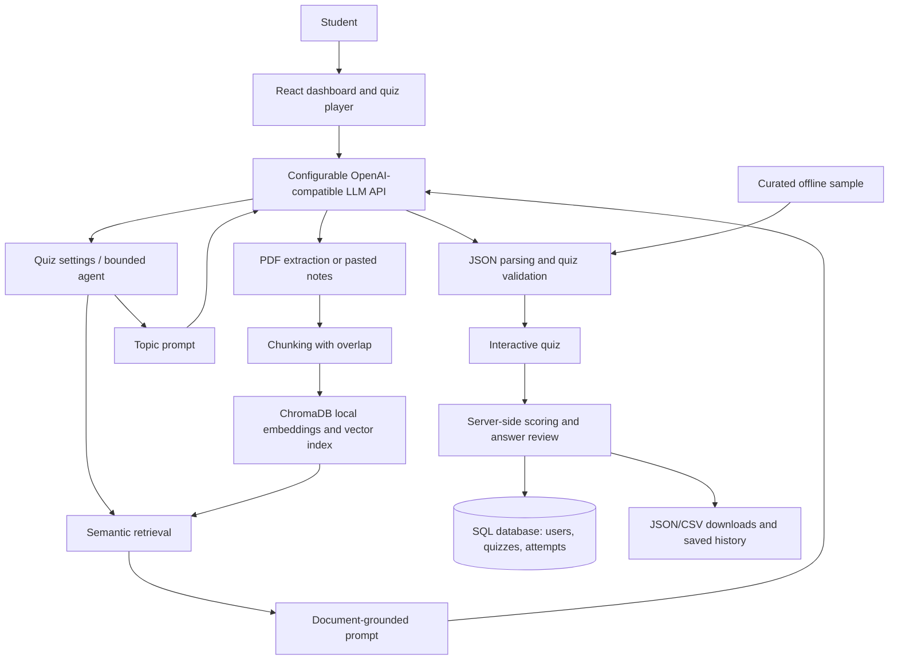

# QuizCraft — AI-Powered Question Generator

QuizCraft is an educational SaaS application with a React/TypeScript frontend and
a FastAPI backend. It supports authenticated quiz generation, PDF and pasted
notes, local semantic retrieval with ChromaDB, a bounded quiz-planning agent,
server-scored attempts, answer review, history, and analytics.

The root `app.py` is a separate, unauthenticated legacy Streamlit prototype. Use
the React/FastAPI account app for the current authenticated experience; do not
use the legacy prototype to store private account data.

> **Important:** Demo mode displays authored sample questions; it does not call an
> LLM and does not use a supplied topic or study document. Document-grounded
> question generation requires a configured LLM API key.

## Abstract

Students often revise from long notes without a quick way to check their
understanding. QuizCraft turns a topic or selected passages from class notes into
four-option questions with answer explanations. For document-based quizzes, it
extracts PDF text, splits it into overlapping chunks, embeds those chunks locally,
retrieves semantically related passages from ChromaDB, and provides only those
passages to a configurable LLM API. Quiz answers are scored by Python, not by the
model.

## Problem statement and objectives

**Problem:** Manual question preparation takes time, and reading large study
documents does not by itself reveal gaps in understanding.

**Objectives**

- Generate validated MCQs for a chosen topic, difficulty, and academic level.
- Support PDFs and pasted text with semantic retrieval rather than sending whole
  documents to the model.
- Provide a transparent, bounded agent that extracts quiz settings and invokes
  the same retrieval and generation functions as the normal workflow.
- Let students attempt, score, review, retake, and export quizzes.
- Keep secrets out of source code and allow the interface to run without an API
  key by using explicitly labeled sample content.

## Existing-system limitations and proposed solution

Preparing questions manually is time-consuming, generic online question banks may
not match a student's notes, and sending full documents to an LLM can waste tokens
and increase irrelevant answers. QuizCraft addresses these limitations with
configurable prompts, local chunk embeddings, similarity retrieval, source
passages, output validation, and Python-based scoring. The application is a study
aid; generated questions still require human review for high-stakes use.

## System architecture



### Workflow

1. Choose **Live AI** or **Curated Demo**.
2. Generate from a topic, or index a PDF/pasted notes under **Study materials**.
3. For document-based generation, enter a query topic. QuizCraft embeds the query,
   retrieves the top passages by cosine similarity, and includes those passages
   in the document-specific prompt.
4. The model returns JSON; the application checks count, unique question text,
   four distinct options, an exact correct option, and an explanation.
5. Attempt the quiz, submit answers, and review the Python-calculated result.
6. Review saved attempts and performance. The authenticated app persists them
   per account; history in the legacy Streamlit prototype is session-only.

## Technology stack and requirements

- React 18, TypeScript, and Vite for the authenticated web interface
- FastAPI and SQLAlchemy for the authenticated API and persistence
- Python 3.11 for the backend and optional legacy Streamlit prototype
- SQLite for local development; PostgreSQL can be configured for deployment
- OpenAI-compatible chat-completions API (Groq is the sample provider)
- ChromaDB local persistent vector database and its default local embedding
  function (`all-MiniLM-L6-v2`)
- pypdf for extracting text from PDF files
- python-dotenv for local `.env` configuration

No separate database server or LLM key is required to run the local app in demo
mode. Live generation requires a valid provider key. Provider free tiers, rate
limits, model availability, and terms can change; confirm current details in
your provider console before use.

## Project structure

```text
QuizCraft/
├── api/                 # FastAPI routes, auth, models, and database
├── frontend/            # React/TypeScript/Vite account application
├── app.py
├── app.css
├── ai_generator.py
├── prompts.py
├── quiz_agent.py
├── rag_pipeline.py
├── vector_store.py
├── pdf_processor.py
├── quiz_utils.py
├── requirements.txt
├── .env.example
├── .gitignore
├── README.md
├── .streamlit/
│   ├── config.toml
│   └── secrets.toml.example
└── tests/
    ├── test_quiz_agent.py
    └── test_quiz_utils.py
```

### Module responsibilities

- `app.py`: top navigation, dashboard, configuration forms, session state,
  PDF/notes indexing, attempt flow, results, performance, and downloads.
- `app.css`: shared visual theme, responsive navigation, cards, form controls,
  progress states, and accessibility focus styling.
- `ai_generator.py`: configurable API request, error handling, JSON extraction,
  and parsing. API keys are passed at runtime and never printed.
- `prompts.py`: system prompt and separate topic/document prompt templates.
- `quiz_utils.py`: output validation, offline sample questions, and score logic.
- `pdf_processor.py`: PDF extraction with empty, encrypted, and scanned-document
  feedback.
- `rag_pipeline.py`: text chunking with overlap and retrieval orchestration.
- `vector_store.py`: ChromaDB collection creation, embedding, and similarity
  search.
- `quiz_agent.py`: regular-expression request planning and bounded tool
  execution; this is intentionally not an unrestricted autonomous agent.

## Legacy Streamlit prototype (optional)

The following commands run the unauthenticated prototype, not the current
React/FastAPI account app:

```powershell
py -3.11 -m venv .venv
.\.venv\Scripts\Activate.ps1
python -m pip install --upgrade pip
python -m pip install -r requirements.txt
Copy-Item .env.example .env
streamlit run app.py
```

If PowerShell blocks virtual-environment activation, either allow it for the
current terminal with `Set-ExecutionPolicy -Scope Process -ExecutionPolicy
Bypass`, or invoke the environment's executable directly:

```powershell
.\.venv\Scripts\python.exe -m pip install -r requirements.txt
.\.venv\Scripts\python.exe -m streamlit run app.py
```

Streamlit opens the prototype (normally at `http://localhost:8501`). Chroma's
first embedding operation may need internet access to download its embedding
model; allow time for the first indexing operation.

## API configuration

### Local development

Edit `.env` (copied from `.env.example`) and set your provider key:

```dotenv
GROQ_API_KEY=your-key-from-the-provider-console
LLM_BASE_URL=https://api.groq.com/openai/v1
LLM_MODEL=openai/gpt-oss-20b
```

The legacy Streamlit prototype can alternatively use
`.streamlit/secrets.toml`. The authenticated React app reads `GROQ_API_KEY` or
`LLM_API_KEY` from the backend environment (normally the project-root `.env`).
Both accept `LLM_BASE_URL` and `LLM_MODEL`. For a different OpenAI-compatible
service, set its documented base URL, model ID, and key. If the provider rejects
the key, verify that it is active for the configured base URL/account, update
the backend environment, and restart the API; key presence alone does not prove
the provider accepts it. HTTP 401 indicates an authentication failure; HTTP 403
is reported separately and may indicate model, project, organization, or account
permissions, so check the structured provider error before changing a key. A
Cloudflare edge error is identified separately from a Groq API response. Never
paste the key into logs, screenshots, or chat. Provider model IDs and JSON-mode
support can change; verify them in the provider documentation if a request is
rejected. The sample Groq model ID
`openai/gpt-oss-20b` is listed in the [Groq structured-output model
documentation](https://console.groq.com/docs/structured-outputs); the application
uses JSON-object mode for compatibility and validates the result itself. The
backend sends a descriptive `QuizCraft/0.1.0` User-Agent; this also helps
distinguish provider-edge filtering from model or credential permissions.

Never commit `.env` or `.streamlit/secrets.toml`. The sample files contain no
working credentials. Do not paste a secret into a screenshot, shared notebook,
or source file. LLM requests send the prompt and (for RAG) retrieved text to the
selected external provider; do not upload material you are not permitted to
share with that provider.

### Demo mode

The legacy Streamlit page uses five authored questions per difficulty. The
authenticated React builder offers five authored sample questions regardless
of whether a Groq key is configured. Both modes are explicitly labeled; neither
calls an LLM or claims to use the requested topic or study material. Live
generation is available only through the React API when the backend key is
configured.

## Prompt engineering and LLM fundamentals

`prompts.py` provides:

- A **system prompt** defining the model's role, schema, one-correct-answer rule,
  clarity requirements, and restriction against unsupported source claims.
- A **topic user prompt** that supplies topic, requested count, academic level,
  and difficulty.
- A separate **document user prompt** that supplies only retrieved passages and
  instructs the model to ground questions in those passages.
- A JSON output schema. `ai_generator.py` requests JSON mode from compatible
  providers; `quiz_utils.py` independently validates the response before the UI
  uses it.

Temperature is set low for more consistent quiz output. The code separates
provider/API handling, prompt construction, model response parsing, and
post-generation validation. Python remains authoritative for scoring.

## RAG pipeline and vector database

`pdf_processor.py` extracts selectable text from PDF pages. Scanned PDFs without
an OCR text layer are reported as unreadable rather than treated as empty RAG
success. Pasted notes use the same chunking/retrieval route. `rag_pipeline.py`
splits material into word-based chunks of 180 words with 35 words of overlap.
`vector_store.py` stores chunk text and source metadata in a persistent local
ChromaDB collection. Chroma's default sentence-transformer embedding function
turns both chunks and a search query into vectors; Chroma performs cosine
similarity retrieval. Chroma anonymized telemetry is disabled for this app. The
top passages are displayed in the material search and
sent to the document-generation prompt. The entire PDF is not sent to the LLM.

Chroma data defaults to `.quizcraft/chroma` and is ignored by Git. It is local to
the machine/container and is not a shared or durable hosted database. On
Streamlit Community Cloud, local files and vector data may disappear on app
rebuild/restart; do not rely on them for persistent user storage. Uploads and
retrieved passages are retained in the current Streamlit session/UI state, while
the indexed chunks remain in the local Chroma directory until that local data is
removed.

## Bounded AI agent

The legacy Streamlit planner in `quiz_agent.py` is regex-based. The authenticated
React app uses the real Groq-backed planner in `api/agent.py`. It validates the
model's topic, difficulty, count, categories, objective, and retrieval choice
with `AgentPlan`, then executes only these fixed Python methods:
`retrieve_study_context`, `generate_quiz`, and `validate_quiz`. Retrieval checks
document ownership. An explicitly selected document forces retrieval; if the
planner requests notes without a document selection, execution stops with a
clear error. Model-proposed tool names or code are never executed. The agent
endpoint is rate-limited and persists a concise execution trace with its quiz.

## Legacy Streamlit interface

The legacy prototype's top navigation opens Dashboard, Create Quiz, Study
Materials, My Quizzes, and Performance. Its analytics and attempt history are
session-only; empty states do not substitute sample analytics. The current
account app's data and analytics are persisted per user in the SQL database.

## Authenticated React workspace

The React/TypeScript account client lives in `frontend/`; its FastAPI service is
`api/`. It provides account creation, sign-in, profile/preferences, quiz creation
and scoring, study document indexing/search, quiz history, performance, study
assistance, and account deletion. User-owned quizzes, questions, attempts, and
document metadata are persisted in SQLAlchemy tables. Dashboard data is queried
from the signed-in user's records only. The legacy Streamlit prototype remains
available separately; it does not authenticate users or use this account
database, and its quiz/history pages must not be treated as private data.

The authenticated vertical navigation sidebar opens Dashboard, Create Quiz,
Study Library, My Quizzes, Performance, Study Assistant, and Profile. Empty accounts
see empty states rather than sample metrics. Study time is not shown as a tracked
statistic. PDF uploads use the existing extraction and Chroma semantic retrieval
modules, but local Chroma files are not durable on ephemeral hosting. The legacy
Streamlit prototype remains separate and unauthenticated; it does not share the
account database or provide private account pages.

### Quiz generation and RAG

The authenticated quiz builder accepts a topic, pasted notes, a PDF uploaded in
the builder, or an already indexed PDF. Inputs are mutually exclusive. Live
generation calls the configurable Groq-compatible chat-completions API from the
backend; set `GROQ_API_KEY`, `LLM_MODEL`, `LLM_BASE_URL`, and optionally
`LLM_TIMEOUT_SECONDS`. The UI checks `/api/ai/status` and labels live AI versus
curated demo mode. Demo mode is five authored sample questions, never calls a
model, and does not claim to use the entered topic or notes.

Live AI currently generates single-answer MCQs. Users select one or more
categories (conceptual, factual recall, scenario-based, problem solving, or code
output); the model must return exactly four distinct options, one matching
correct answer, an explanation, and a selected category. The player and scorer
also support multiple-select questions when those records are present, but that
format is not currently generated by the normal prompt. Backend validation
rejects duplicates, invalid categories, malformed answers, and invalid or
missing citations. Questions persist their type, category, creation time, and
retrieved source passages; answer keys are not returned until submission review.

PDFs are limited to 15 MB, 250 pages, 500,000 extracted text characters, and
512 chunks per upload. PDFs are extracted with `pypdf`, chunked with overlap,
and embedded by Chroma's local default sentence-transformer model
(`all-MiniLM-L6-v2`).
Chroma embeds the query and retrieves by cosine similarity; keyword matching is
not used as a substitute. Pasted notes use a temporary vector collection that
is removed after generation. Per-user SHA-256 fingerprints reject duplicate
PDFs. Retrieved passage references are stored with questions and shown in the
player only when real retrieval context was used. The first embedding may
download model files and needs internet access; the local Chroma directory is
not persistent storage on ephemeral hosting.

### Interactive player and library

The React player shows one question at a time with a progress bar, question
overview, previous/next controls, and mark-for-review state. It supports
single-answer questions and multiple-answer selection when the stored question
type requires it. In-progress answers and the current question are stored in
the current browser tab's `sessionStorage` and restored on refresh; they are
cleared on sign-out. Submission is confirmed and scored in Python; unanswered
questions are submitted as incorrect rather than blocking submission. Review
shows correctness, explanations, and cited passages; results can be downloaded
as JSON and quizzes can be retaken. No countdown timer is currently implemented.

The Study Library persists a document row only after PDF extraction, chunking,
embedding, and vector insertion all succeed. The UI lists successfully indexed
files with extracted previews and passage counts, provides semantic search and a
direct create-from-document action, and deletes the Chroma collection together
with its owned metadata. SHA-256 fingerprints prevent a user from indexing the
same PDF twice. Vector storage is local; configure durable shared storage before
deploying to an ephemeral host.

### Quiz history, analytics, and assistant

My Quizzes supports topic search, difficulty and creation-date filters, recent
activity/best-score sorting, saved attempt review, question bookmarks, and JSON
or CSV quiz exports. Quiz deletion cascades through questions, settings,
attempts, and bookmarks. Performance uses only stored attempts and reports best
score, topic/difficulty averages, score history, and first-half versus
second-half improvement when at least four attempts exist. A weak-topic
recommendation requires at least two attempts below the user's overall average;
otherwise no weak area is inferred.

The AI Study Assistant supports concept explanations, follow-up questions,
answer explanations, revision-topic suggestions, uploaded-document summaries,
and revision plans. Document requests retrieve owned passages and display their
references. Revision suggestions use actual quiz history; a new account receives
an honest no-history response. Other general answers are labeled as general
model knowledge.

### Run the account experience on Windows

Copy `.env.example` to `.env`. Keep the local values for development. Open two
VS Code terminals at the project root and run:

```powershell
py -3.11 -m pip install -r requirements.txt
py -3.11 -m uvicorn api.main:app --reload --host 127.0.0.1 --port 8000
```

In the second terminal:

```powershell
npm.cmd install --prefix frontend
npm.cmd run dev --prefix frontend
```

Open `http://127.0.0.1:5173` or `http://localhost:5173`; the frontend selects
the matching local API hostname so CSRF cookies remain same-site. The API health
check is at `http://127.0.0.1:8000/api/health` and checks database connectivity.

For production, build the frontend with `VITE_API_BASE_URL` set in
`frontend/.env` when the API is on a different origin; otherwise route `/api`
through a same-origin reverse proxy. `VITE_API_BASE_URL` is public build
configuration and must never contain a secret. Set
`QUIZCRAFT_FRONTEND_ORIGINS` to the exact deployed frontend origin(s), use a
managed `QUIZCRAFT_DATABASE_URL`, and set `QUIZCRAFT_COOKIE_SECURE=true` over
HTTPS. Secure cookies use `SameSite=None` so browsers send them for the separate
frontend/API deployment; CSRF validation remains enabled. Browsers may still
restrict third-party cookies, so same-site hosting or a reverse proxy is
preferable.

This project is not yet production-ready without additional operations work:
SQLAlchemy creates tables at startup but Alembic migrations are not configured;
Chroma data is stored on the local filesystem and needs persistent, appropriately
shared storage; and rate limits are process-local. Plan durable backups,
migrations, shared vector storage, and distributed rate limiting before scaling
or deploying to ephemeral/multi-instance infrastructure. Process environment
variables intentionally take precedence over the project `.env`. Password
reset and email verification are unavailable.

Passwords are hashed with Argon2id. Session tokens are random, stored server-side
as hashes, and sent in HttpOnly cookies; unsafe API calls require a CSRF token.
Sign-in and registration are rate-limited. Password reset and email verification
are explicitly unavailable until an email provider and expiring token workflow
are configured. Do not deploy the legacy Streamlit pages as private account
pages; they remain outside this auth boundary.

## Legacy Streamlit quiz and results

The attempt page shows one question at a time with previous/next navigation.
Unanswered questions prevent submission. `calculate_score` compares selected
options to the validated answer key in Python and records total, correct,
incorrect, percentage, summary, and question review. Users can retake, download
the question set, download results, and see completed quizzes for the current
session. No authentication or cross-session result database is implemented.

## Legacy Streamlit prototype deployment

This deployment path serves only the unauthenticated `app.py` prototype; it
does not deploy the React frontend or FastAPI account API.

1. Push this project to a GitHub repository without `.env`,
   `.streamlit/secrets.toml`, or `.quizcraft/`.
2. Create a Streamlit Community Cloud app and select the repository, branch, and
   `app.py` as the main file.
3. In the app's **Settings → Secrets**, add:

   ```toml
   LLM_API_KEY = "your-provider-key"
   LLM_BASE_URL = "https://api.groq.com/openai/v1"
   LLM_MODEL = "openai/gpt-oss-20b"
   ```

4. Deploy. The dependency list is in `requirements.txt`; Python 3.11 is
   recommended. If the host's default Python differs, select Python 3.11 in the
   deployment settings where available.
5. Test the demo first, then test API generation and document retrieval with
   non-sensitive material. Local Chroma storage is ephemeral on hosted
   deployments, and the embedding model download consumes startup time and
   deployment storage.

This repository only prepares deployment configuration; it does not claim the
app has been deployed.

## Testing

Run the local unit tests:

```powershell
python -m unittest discover -s tests -v
```

Run a syntax check:

```powershell
python -m compileall -q app.py ai_generator.py prompts.py quiz_agent.py rag_pipeline.py vector_store.py pdf_processor.py quiz_utils.py tests
```

### Manual demonstration checklist

1. Launch the app without an API key and choose Demo mode; confirm the notice
   identifies curated sample questions.
2. Generate a five-question Easy, Medium, and Hard demo quiz separately.
3. Navigate back and forward, answer all five, and submit; verify score and
   explanations, then retake and download quiz/results JSON.
4. Try an empty topic and an unindexed document-based quiz; verify clear errors.
5. Configure a valid API key and generate a topic quiz for each difficulty and
   count (5, 10, 15); inspect four distinct choices and one matching answer per
   question.
6. Paste a short set of notes into **Study materials**, index it, search a
   distinctive concept, and inspect retrieved passages.
7. Generate a document-grounded quiz about that concept; confirm the displayed
   passages are the retrieved context used by the prompt.
8. Upload a text-based PDF and repeat indexing, retrieval, and quiz generation.
   Try a scanned/encrypted/invalid PDF and check its explanatory error.
9. In the agent, try “Prepare 10 medium-level DBMS questions from my uploaded
   notes.” with the material toggle enabled; check its parsed plan and output.
10. Try a wrong API key, provider rate limit, or offline provider; confirm the
    UI reports an error and does not describe the result as successful.
11. Inspect `.gitignore` and confirm no API key is shown in the app or logs.

Automated tests cover quiz validation and scoring, all three sample difficulty
levels, chunk overlap, and agent request parsing. They do not call an external
LLM or download a Chroma embedding model. The PDF, real API, and end-to-end
semantic-retrieval checks require a local/manual run with the relevant sample
files and provider access.

The authenticated frontend production build can be checked with:

```powershell
npm.cmd run build --prefix frontend
```

## 2–3 minute demonstration script

1. **0:00–0:20 — Introduce:** “QuizCraft is a full-stack study assistant. It can
   generate validated MCQs from a topic or retrieved passages in my notes.”
2. **0:20–0:45 — Demo mode:** Open Create a quiz, select Demo mode, and make a
   medium quiz. Point out that the UI explicitly identifies it as curated sample
   content, so it is not misrepresented as model output.
3. **0:45–1:15 — Attempt and results:** Answer questions using previous/next,
   submit, and show that Python calculates the score and displays explanations.
4. **1:15–1:45 — RAG:** Paste a short note or upload a PDF, index it, search a
   concept, and show the retrieved passages. Explain that only relevant chunks
   are provided to the model.
5. **1:45–2:15 — LLM / agent:** If a key is available, generate a
   document-grounded quiz and/or enter “Prepare 5 easy DBMS questions from my
   notes” in the bounded agent. Show its parsed settings and validated output.
6. **2:15–2:40 — Explain design:** Show the result download and name the modules:
   prompts, API client, PDF extraction, Chroma retrieval, validation, and
   Python scoring. Mention the provider key is stored in secrets, not code.

## Viva questions and concise answers

1. **What problem does QuizCraft solve?** It reduces the effort to create
   practice questions and lets students check understanding from their own
   notes.
2. **What is an LLM?** A large language model predicts and generates text from
   learned language patterns and the prompt context.
3. **What is prompt engineering here?** Structuring system and user instructions
   so generated questions follow the requested difficulty and JSON contract.
4. **What is the system prompt for?** It sets persistent role, content, and
   output-format rules for the model.
5. **What is RAG?** Retrieval-Augmented Generation retrieves relevant source
   passages and supplies them as context to generation.
6. **Why chunk documents?** Chunks make retrieval focused and avoid sending the
   full document on each generation request.
7. **Why use overlap?** Shared words preserve context when a sentence or concept
   falls across a chunk boundary.
8. **What is an embedding?** A numerical vector representing semantic features
   of text.
9. **How does semantic search work in the project?** Chroma embeds the query and
   chunks and ranks chunks by cosine similarity.
10. **Why ChromaDB?** It is a lightweight local vector database that avoids
    requiring a separate database server.
11. **How is the application an agent?** A bounded Python planner extracts
    settings and calls explicitly defined retrieval, generation, and validation
    functions.
12. **How is the score calculated?** Python compares the selected option with
    each validated correct answer; the model never supplies the score.
13. **How are model responses checked?** The response is parsed as JSON and
    checked for the exact question count, four distinct options, an answer that
    matches one option, explanations, and duplicates.
14. **How are API secrets protected?** The authenticated backend reads keys from
    environment variables or the project-root `.env`; they are not committed or
    printed. Only the legacy Streamlit prototype uses Streamlit secrets.
15. **What happens without an API key?** The user can run an explicitly labeled
    five-question sample quiz; custom topic and document generation remain
    unavailable.
16. **Can the project read scanned PDFs?** Not without OCR; it reports that no
    selectable text was found and asks for OCR text or pasted notes.
17. **What are the limitations?** Model output can still be wrong, external API
    use sends prompt/context to the provider, and hosted local vector storage is
    temporary.
18. **How could the project be extended?** Add OCR, user authentication,
    persistent result storage, source citations per question, and provider-specific
    structured-output adapters.

## Limitations and future enhancements

- LLM output needs human review; validation checks structure, not factual truth.
- The default PDF parser extracts selectable text and does not perform OCR.
- The default embedding model downloads on first use and requires compatible
  runtime resources.
- The API provider receives the prompt and retrieved excerpts for LLM requests.
- Agent parsing is intentionally simple and supports a limited set of counts and
  difficulty terms.
- Legacy Streamlit history is session-only; authenticated account history is
  persisted in the configured SQL database.
- Future improvements could add OCR, durable shared vector storage, richer agent
  intent parsing, and provider-specific model adapters.

## Requirement coverage

| Requirement | Implementation |
|---|---|
| Responsive dashboard, top navigation, builder, material workspace, history, performance | `app.py`, `app.css`, `.streamlit/config.toml` |
| Topic-based LLM generation and configurable provider | `ai_generator.py`, `.env.example`, Streamlit secrets |
| Separate system/topic/document prompts | `prompts.py` |
| PDF processing and pasted notes | `pdf_processor.py`, `app.py` |
| Embeddings, local vector database, semantic retrieval | `vector_store.py`, `rag_pipeline.py` (ChromaDB default embedding function) |
| Transparent quiz planning agent | `quiz_agent.py`, agent section in `app.py` |
| Quiz attempt, Python scoring, explanation review | `app.py`, `quiz_utils.py` |
| Session history and JSON downloads | `app.py` |
| Offline demo with truthful labeling | `quiz_utils.py`, `app.py` |
| Deployment preparation and secrets examples | `requirements.txt`, `.streamlit/`, this README |
| Full external API and end-to-end test coverage | Manual tests documented above; requires API/provider and local embedding model |
